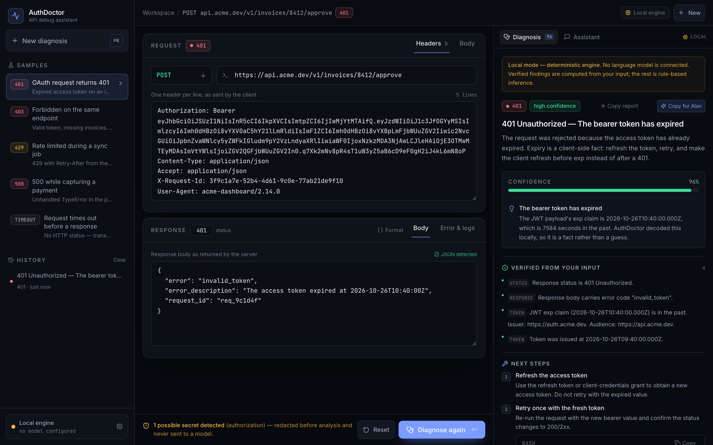
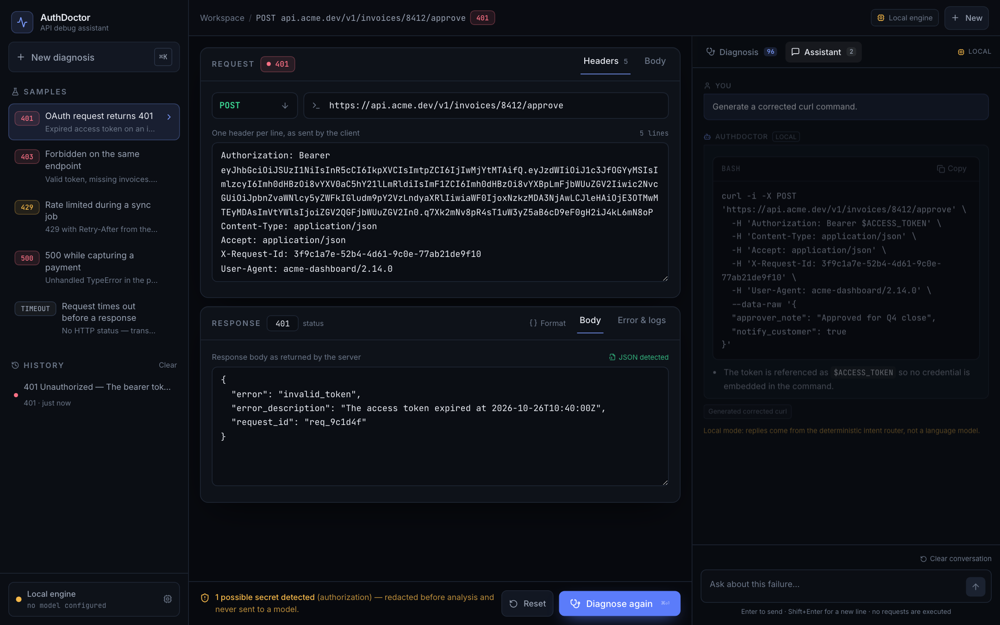
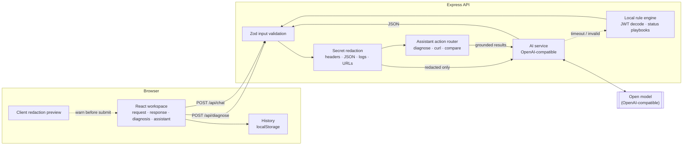

# AuthDoctor

[](https://github.com/mathurraghav01/authdoctor/actions/workflows/ci.yml) [](LICENSE)

**An open-source debugging workspace for failed API requests.** Paste the request, the response, the error and any server logs. AuthDoctor separates what it can verify from what it is inferring, then gives you a root cause, a fix, next steps and a corrected `curl` command.

Built for the **OpenFire Hackathon** — open source, open models, and a first-class handoff into an Alan AI session.



## Why

Most debugging time is lost between “the API returned 401” and “here is the actual cause”. Docs explain status codes in general; they do not read *your* request. AuthDoctor is a focused workspace for that gap:

- **Authentication vs authorization, precisely.** 401 means the identity was rejected. 403 means the identity was accepted and the permission was not. Refreshing a token never fixes a missing scope.
- **Verified vs likely.** An expired JWT `exp` claim is decoded locally and reported as fact. “The signing key may have rotated” is labelled as an inference.
- **Secrets never reach the model.** Bearer tokens, cookies, API keys, passwords and connection strings are redacted on the server before analysis.
- **Nothing is executed.** AuthDoctor never sends your request to the target API. The corrected `curl` command is for you to review and run.

## Features

| Area | What works |
| --- | --- |
| Input | Method, URL, status code, headers, request body, response body, client error, server logs |
| Samples | 401 expired OAuth token, 403 missing scope, 429 rate limit, 500 with stack trace, network timeout |
| Diagnosis | Summary, likely cause, confidence, evidence, alternatives, ordered steps, suggested fix, corrected `curl`, security notes |
| Verification | Local JWT decode (`exp`, `iat`, `iss`, `aud`, `scope`), status/header/error-code/log checks |
| Assistant | “Diagnose this 401”, “Generate a corrected curl”, “Difference between 401 and 403”, “What next?”, redaction report |
| Privacy | Server-side redaction, client-side warning before submission, no server-side persistence |
| Workflow | One-click samples, copyable code, local history, reset, keyboard shortcuts, responsive layout |
| Engines | Any OpenAI-compatible open model, or a deterministic local engine with no key at all |

## Quick start

Requirements: **Node.js 20+** (22 recommended).

```bash
git clone <your-fork-url> authdoctor
cd authdoctor
npm install
npm run dev
```

- Web app: <http://localhost:5173>
- API: <http://localhost:8787>
- Health: <http://localhost:8787/api/health>

No API key is required. With no model configured, AuthDoctor runs in **Local mode**: a deterministic rule engine diagnoses the request and the assistant routes your commands to real workspace actions. The UI labels that mode explicitly rather than pretending a model is answering.

Production build, one process for API and web:

```bash
npm run build
npm start            # http://localhost:8787
```

## Connect an open model

AuthDoctor speaks the standard OpenAI Chat Completions protocol, so it works with any open-model host: the OpenFire credit endpoint, OpenRouter, Groq, Together, vLLM, LM Studio or Ollama.

```bash
cp .env.example .env
```

```dotenv
AI_BASE_URL=https://openrouter.ai/api/v1
AI_MODEL=meta-llama/llama-3.3-70b-instruct:free
AI_API_KEY=your-key
```

Restart the server. The sidebar flips to **Open model connected** and the diagnosis engine becomes the model. Keys live only in the server process; the browser never receives one.

| Variable | Required | Default | Purpose |
| --- | --- | --- | --- |
| `AI_BASE_URL` | for model mode | — | OpenAI-compatible base URL **without** `/chat/completions` |
| `AI_MODEL` | for model mode | — | Model id accepted by that provider |
| `AI_API_KEY` | usually | — | Sent as `Authorization: Bearer …`; omitted for local servers such as Ollama |
| `AI_TIMEOUT_MS` | no | `45000` | Upstream request timeout |
| `AI_MAX_TOKENS` | no | `1600` | Completion budget |
| `PORT` | no | `8787` | API port |
| `ALLOWED_ORIGINS` | no | localhost:5173 | CORS allow-list |

A provider is considered configured only when **both** `AI_BASE_URL` and `AI_MODEL` are set. Misconfiguration degrades to Local mode; it never crashes the request.

## Alan AI integration

This project was built inside Alan with open models. The integration is deliberately narrow and honest:

**What is wired**
- The model layer calls `POST {AI_BASE_URL}/chat/completions` — the same protocol Alan's open-model access uses. Any Alan-issued endpoint and key drops straight in with no code change.
- The in-app assistant is **tool-grounded**: natural commands are first executed as real workspace actions (run the diagnosis, build `curl`, compare status codes, read the redaction report), and those results are supplied to the model. The model cannot invent a `curl` command or a diagnosis because it only explains computed results.
- 

**Copy for Alan** on every diagnosis copies a self-contained, redacted briefing (request, engine, verified vs likely findings, fix, `curl`) into an Alan session so the investigation can continue with the agent.

**What is not available, and the exact missing piece**
- This build was created in an environment with **no Alan inference credential injected**. Alan's MCP tools are capabilities of the host agent session, not a public HTTP API a third-party web app can call with a browser token — so wrapping them here would mean inventing an integration. It was not done.
- To run in model mode you need: a base URL, a model id, and an API key for an OpenAI-compatible endpoint (`AI_BASE_URL`, `AI_MODEL`, `AI_API_KEY`). That is the only missing requirement. Everything else — schema validation, repair pass, timeout handling, fallback — is implemented and tested.

If you are wiring this into a specific Alan deployment, set those three variables and use **Copy for Alan** as the handoff boundary.

## Architecture



**Diagnosis pipeline**

1. Validate the payload with Zod (bounded field sizes, numeric status).
2. Redact every free-text field; count findings by kind.
3. If a model is configured, send **only the redacted copy** with a JSON-only system prompt.
4. Parse the response tolerantly (fences/prose), validate against a strict schema, and make **one repair attempt** on failure.
5. Normalise honesty rules in code: high confidence requires verified evidence, and `curl` output is stripped of literal secrets.
6. On timeout, upstream error or a second invalid response, return the deterministic local diagnosis with an explicit `local-fallback` engine label.

**Directory layout**

```
authdoctor/
├── client/                 React 18 · Vite · TypeScript · Tailwind
│   ├── src/components/     Sidebar, editors, diagnosis panel, assistant
│   ├── src/lib/            API client, types, formatting, redaction preview
│   └── src/data/samples.ts Five realistic demo failures
├── server/                 Node · Express · TypeScript
│   ├── src/routes/         /api/diagnose, /api/chat, /api/health
│   ├── src/services/       ai.ts, localEngine.ts, assistant.ts
│   ├── src/utils/          redact.ts, request.ts
│   └── src/__tests__/      Vitest suites
├── docs/screenshots/
├── Dockerfile
└── .github/workflows/ci.yml
```

## The diagnosis contract

The model must return one JSON object matching this schema (`server/src/schema.ts`). Anything else is rejected and retried once, then falls back.

```json
{
  "title": "401 Unauthorized — the bearer token has expired",
  "summary": "…",
  "likelyCause": { "cause": "…", "confidence": "high", "rationale": "…" },
  "confidence": 0.96,
  "evidence": [{ "source": "token", "detail": "exp is in the past", "verified": true }],
  "alternatives": [{ "cause": "clock skew", "likelihood": "low", "note": "…" }],
  "steps": [{ "title": "Refresh the token", "detail": "…", "command": "…" }],
  "fix": { "summary": "…", "code": { "language": "typescript", "content": "…" }, "notes": [] },
  "curl": "curl -i … -H 'Authorization: Bearer $ACCESS_TOKEN'",
  "securityRisks": [{ "risk": "…", "severity": "medium", "detail": "…" }],
  "verifiedFindings": ["…"],
  "likelyFindings": ["…"],
  "needsMoreInfo": ["…"]
}
```

The UI renders verified findings and inferences in separate sections, and every report ends with: *review before applying; nothing here was executed or tested.*

## Security and privacy

- **Redaction before analysis.** `Authorization`, `Proxy-Authorization`, `Cookie`, `Set-Cookie`, `X-Api-Key`, `X-Auth-Token` and similar headers are masked. JSON keys such as `password`, `client_secret`, `access_token` and `private_key` are masked structurally. Free text is scanned for JWTs, `sk-…`, GitHub/Slack/AWS/Google key shapes, private keys, connection strings and secret query parameters.
- **Warned before submission.** The client highlights likely secrets and their kinds before you run a diagnosis.
- **No credential logging.** Request bodies are never logged. The server logs only startup state and unhandled error messages.
- **No execution.** No endpoint, shell command or `curl` is ever run by the app.
- **No server-side history.** Only **redacted** diagnosis snapshots are written to your browser's `localStorage`; the live draft is never persisted, and “Clear” removes saved entries. Restoring a snapshot warns that its credentials are placeholders.
- **Untrusted input.** Logs and API responses are data. JSON is parsed defensively, model output is schema-validated, and Markdown rendering does not allow raw HTML.
- **Review required.** Fixes are suggestions. AuthDoctor explicitly does not claim a fix was tested.

Operational caveat: the demo rate limiter is in-process memory (40 requests/minute per IP). Use a shared store for multi-instance deployments.

## Demo flow (2 minutes)

1. Open the workspace and load **OAuth request returns 401** from the sidebar. Note the redaction warning: one credential will be masked.
2. Press **Diagnose API request**. The panel shows a decoded `exp` claim as *verified*, then the likely cause at 96% confidence.
3. Ask the assistant: **“Generate a corrected curl command.”** The command references `$ACCESS_TOKEN`, never the literal token.
4. Load **Forbidden on the same endpoint** and diagnose. The same endpoint returns 403 with a valid token; the cause is a missing `invoices.write` scope, and the fix is explicitly *not* “refresh the token”.
5. Ask **“Show me the difference between 401 and 403.”** Then use **Copy for Alan** to hand the redacted briefing to an Alan session.

Everything above works with zero configuration in Local mode.

## Tests

```bash
npm test          # 33 Vitest cases
npm run typecheck # server + client
npm run build     # server tsc + client vite build
npm run lint      # client ESLint
```

Covered: header/JSON/free-text/query redaction and idempotence, JWT expiry and scope decoding, all five sample failure classes, confidence behaviour for thin evidence, generated `curl` never containing a token, assistant intent routing, and tolerant JSON extraction from model output.

## Deployment

**Docker (API + built client in one container):**

```bash
docker build -t authdoctor .
docker run -p 8787:8787 \
  -e AI_BASE_URL=https://your-endpoint/v1 \
  -e AI_MODEL=your-model \
  -e AI_API_KEY=your-key \
  authdoctor
```

Open <http://localhost:8787>. Without the model variables it runs in Local mode.

**Render / Railway / Fly.io:** deploy the Dockerfile, set `PORT` (Render provides it), add the AI variables as secrets, and set `ALLOWED_ORIGINS` if you serve the frontend from a different origin. The Express server serves `client/dist` and falls back to `index.html`, so no separate static host or proxy is needed.

**Static split:** build the client with `npm --workspace client run build`, host `client/dist` anywhere, then set `VITE`-time proxy or point the app at the API via a reverse proxy. The server CORS list is controlled by `ALLOWED_ORIGINS`.

## Limitations

- Local mode is a rule engine, not a general reasoner. It is strong on auth, rate limits, timeouts and common 4xx/5xx classes; unusual failures need a model.
- Confidence is a calibrated heuristic, not a statistical guarantee.
- Streaming responses are not implemented; model calls return a complete JSON diagnosis.
- Alan's MCP session tools are not callable from a browser app, so the integration is the model endpoint plus the explicit copy-for-Alan handoff (see above).
- Demo samples use static JWTs. Their payloads are inspectable and were minted for this repository; they are not live credentials.
- In-memory rate limiting and localStorage history are intentionally demo-grade.

## License

MIT — see [LICENSE](LICENSE).